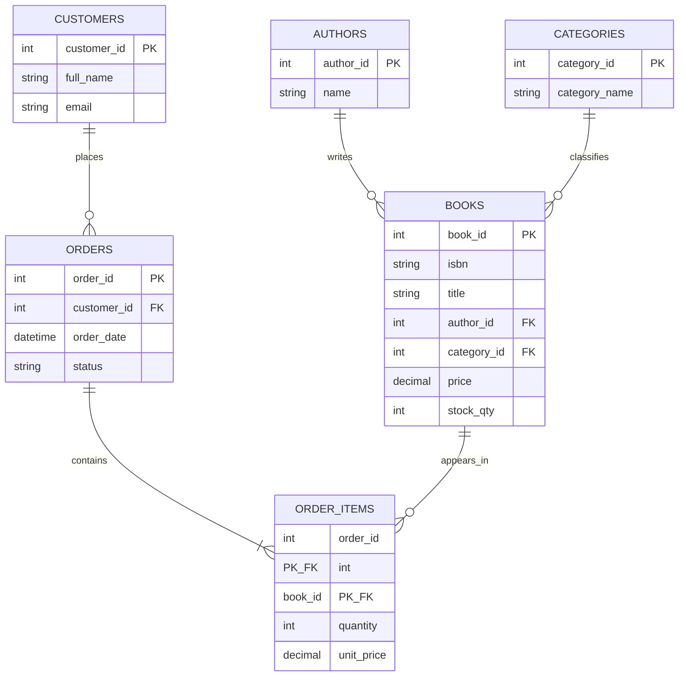

# Page & Pine Bookstore Manager

**Project type:** Relational database application  
**Author:** Duane Harris  
**Technology:** PHP 8, PDO, MySQL 8, HTML, CSS, JavaScript  
**Local environment:** XAMPP  
**Repository URL:** https://github.com/duaneX1504/bookstore-management-system

Page & Pine is a small bookstore management system. It tracks a book catalog, available stock, customers, and customer orders. The dashboard supports book create, read, update, and delete actions, search and category filtering, CSV export, and order-status updates. REST-style JSON endpoints provide the database operations.

## Features

- Manage books, including ISBN, title, author, category, publisher, price, and stock.
- Store author, category, and customer records in separate related tables.
- Create orders containing one or more books. The API checks stock, saves the order and its line items in a transaction, and reduces stock.
- Update order status. Cancelling an order restores its reserved stock.
- View order totals and line items, and search/filter the book inventory.
- Export the current book catalog as CSV.
- Use prepared statements, input validation, JSON responses, HTTP status codes, and relational foreign-key constraints.

## Database design

The schema uses six tables. `books` references `authors` and `categories`. `orders` references `customers`. `order_items` connects orders to books and uses a composite primary key so one book appears at most once per order. The unit price is saved with the order item so an order retains the price charged at checkout.



The schema enforces unique ISBNs, unique author emails when provided, unique customer emails, unique category names, valid foreign keys, nonnegative prices and stock, and positive order quantities. Order creation and stock deduction happen inside a database transaction.

## Requirements

- XAMPP with Apache, PHP 8 or newer, and MySQL/MariaDB
- A browser
- Postman or another HTTP client for API demonstrations

## Recreate the project in XAMPP

1. Copy the `bookstore-management-system` folder into `C:\xampp\htdocs\`.
2. Start **Apache** and **MySQL** from the XAMPP Control Panel.
3. Open `http://localhost/phpmyadmin`.
4. Select **Import**, choose `database/schema.sql`, then select **Import**. This creates and seeds `bookstore_db`.
5. Copy `config.example.php` to `config.php`. The defaults work with a standard local XAMPP installation (`127.0.0.1`, database `bookstore_db`, user `root`, blank password). If your MySQL password differs, update `config.php`.
6. Open `http://localhost/bookstore-management-system/`.

The SQL file includes sample authors, categories, books, customers, and orders, so the dashboard has data on first launch. The project uses its own `bookstore_db` database and does not modify `university_practice`.

## API reference

Base URL: `http://localhost/bookstore-management-system/api/api.php`

Pass a resource name in the query string: `books`, `authors`, `categories`, `customers`, or `orders`.

| Operation | HTTP request | Result |
| --- | --- | --- |
| List books | `GET ?resource=books` | Book records with author and category names |
| Read a book | `GET ?resource=books&id=1` | One book or `404` |
| Add a book | `POST ?resource=books` | Creates a book and returns `201` |
| Update a book | `PUT ?resource=books&id=1` | Updates book fields |
| Delete a book | `DELETE ?resource=books&id=1` | Deletes the book if no order line refers to it |
| List orders | `GET ?resource=orders` | Orders with customer, total, and line items |
| Create order | `POST ?resource=orders` | Saves an order and deducts available stock |
| Update order status | `PUT ?resource=orders&id=1` | Changes order status |
| Delete order | `DELETE ?resource=orders&id=1` | Deletes the order and restores reserved stock |

Example create-book JSON:

```json
{
  "isbn": "9780000000001",
  "title": "Example Book",
  "author_id": 1,
  "category_id": 1,
  "publisher": "Example Press",
  "price": 18.99,
  "stock_qty": 12
}
```

Example create-order JSON:

```json
{
  "customer_id": 1,
  "items": [
    { "book_id": 1, "quantity": 2 },
    { "book_id": 2, "quantity": 1 }
  ]
}
```

The API returns JSON. Typical response codes include `200` for successful reads/updates/deletes, `201` for a successful create, `400` for an invalid request, `404` for a missing resource, `409` for a duplicate or related-record conflict, and `422` for invalid values.

## Postman demonstration

1. Create a request with method **GET** and URL `http://localhost/bookstore-management-system/api/api.php?resource=books`.
2. Select **Send** and show the JSON book list.
3. Create a **POST** request to the same URL, select **Body → raw → JSON**, and paste the create-book example. Select **Send** and show the `201` response.
4. Use **PUT** with `?resource=books&id=5` and a complete JSON book record to change the new book's stock or price.
5. Use **DELETE** with `?resource=books&id=5` to remove the test record.
6. To demonstrate order and stock behavior, POST the example order to `?resource=orders`, then GET `?resource=books` and point out the reduced stock. Change the order status to `Cancelled` with PUT `?resource=orders&id=<returned id>` and show stock restored.

## Repository setup

The source is published at [github.com/duaneX1504/bookstore-management-system](https://github.com/duaneX1504/bookstore-management-system). To download the project with Git and its version history, run:

```bash
git clone https://github.com/duaneX1504/bookstore-management-system.git
cd bookstore-management-system
```

Do not commit a `config.php` containing a real database password. The repository includes `config.example.php` for local setup.

## Project structure

```text
bookstore-management-system/
├── api/
│   ├── api.php
│   └── db.php
├── assets/
│   ├── app.js
│   └── styles.css
├── database/
│   └── schema.sql
├── docs/
│   ├── class-presentation.pptx
│   ├── project-report.docx
│   └── PROJECT_REPORT.md
├── screenshots/
│   ├── bookstore-dashboard.png
│   ├── book-form.png
│   └── database-erd.png
├── config.example.php
├── index.php
└── README.md
```

## Known scope

This is a classroom demonstration system. It does not include user accounts, staff permissions, payment processing, shipping-provider integration, or production hosting. The sample records are fictional and can be changed in `database/schema.sql`.
