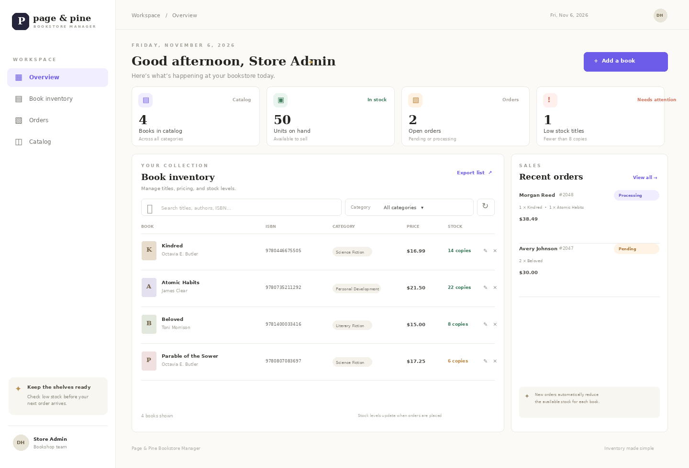
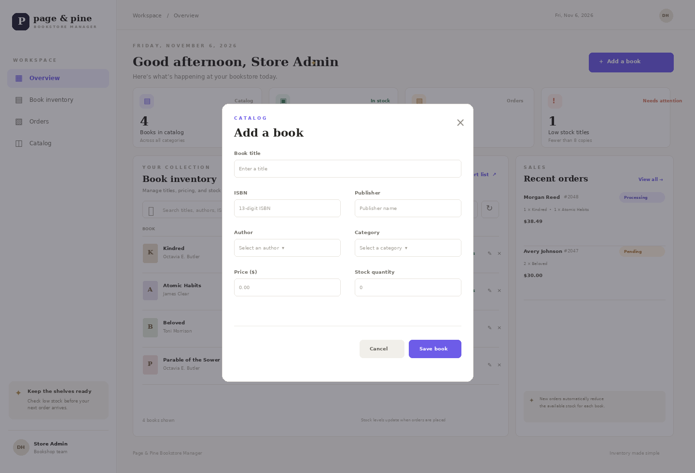

# Page & Pine Bookstore Management System

**Student:** Duane Harris  
**Presentation date:** November 19, 2026  
**Repository URL:** https://github.com/duaneX1504/bookstore-management-system

## Project overview

Page & Pine is a bookstore inventory and order management system. It gives a store employee one dashboard to review the catalog, search for a title, see stock levels, and maintain book records. It also tracks customers and orders. The project demonstrates how a relational database supports a small business workflow from catalog entry through an order and inventory change.

## Technologies

| Layer | Technology |
| --- | --- |
| Frontend | HTML, CSS, JavaScript |
| Backend | PHP 8 using PDO |
| Database | MySQL 8 / MariaDB |
| Local server | XAMPP Apache and MySQL |
| API format | REST-style HTTP requests with JSON responses |

## Database design

The database has six normalized tables: `authors`, `categories`, `books`, `customers`, `orders`, and `order_items`. Book details refer to an author and category through foreign keys. Each customer can place multiple orders. An order can contain multiple books, and books can appear in many orders. The `order_items` table resolves that many-to-many relationship using a composite primary key (`order_id`, `book_id`). It also keeps the quantity and unit price charged for each book.

The schema adds unique constraints for ISBN, customer email, and category name. Foreign keys protect related records from accidental deletion. A database transaction creates an order, checks available quantities, writes its line items, and deducts stock as a single operation. If one item is unavailable, the transaction rolls back. Cancelling an order restores its reserved stock.

## Frontend

The dashboard shows total catalog titles, total units on hand, open orders, and titles with fewer than eight copies. The inventory table includes title, author, ISBN, category, price, and quantity. Employees can search by title, author, or ISBN, filter by category, add a title, edit an existing record, remove a title, refresh the page data, and export the catalog as a CSV file. Recent orders show customer, order items, total, and current status. The status selector updates an order through the API.

## Backend API

The PHP API uses prepared PDO statements and validates values before writing to MySQL. It returns JSON with HTTP status codes. The books, authors, categories, and customers resources support list, read by ID, create, update, and delete operations. Orders support list/read, transactional creation with stock deduction, status updates, and deletion with stock restoration. Errors cover malformed JSON, missing records, invalid values, duplicate records, and database relationship conflicts.

Example endpoints:

- `GET /api/api.php?resource=books`
- `GET /api/api.php?resource=books&id=1`
- `POST /api/api.php?resource=books`
- `PUT /api/api.php?resource=books&id=1`
- `DELETE /api/api.php?resource=books&id=1`
- `POST /api/api.php?resource=orders`
- `PUT /api/api.php?resource=orders&id=1`

## Screenshots

### Bookstore dashboard

The screenshot shows the dashboard with seeded example books and orders, including the inventory controls and store summary.

### Book record form

The project also includes a form for adding or editing a book, with fields for title, ISBN, publisher, author, category, price, and quantity.

## Setup and demonstration

The repository README provides complete recreation steps. In brief, place the project folder under `C:\xampp\htdocs`, start Apache and MySQL, import `database/schema.sql` through phpMyAdmin, copy `config.example.php` to `config.php`, and open the local dashboard in a browser. The SQL file creates `bookstore_db` and inserts example data.

For the live demonstration, add a book through the dashboard, edit its stock, and delete the test record. Then use Postman to create an order and show the stock count decrease. Change its status to Cancelled and show the stock count return. This demonstrates the frontend, API, database relationships, and inventory transaction.

## Project repository

GitHub repository: https://github.com/duaneX1504/bookstore-management-system

## Scope and future improvements

This classroom version does not include logins, role permissions, payment processing, shipping integrations, or public hosting. A next version could add authentication, sales reports, barcode scanning, and low-stock purchase orders.
