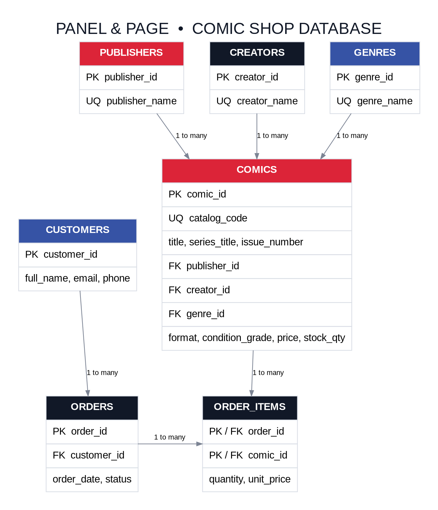
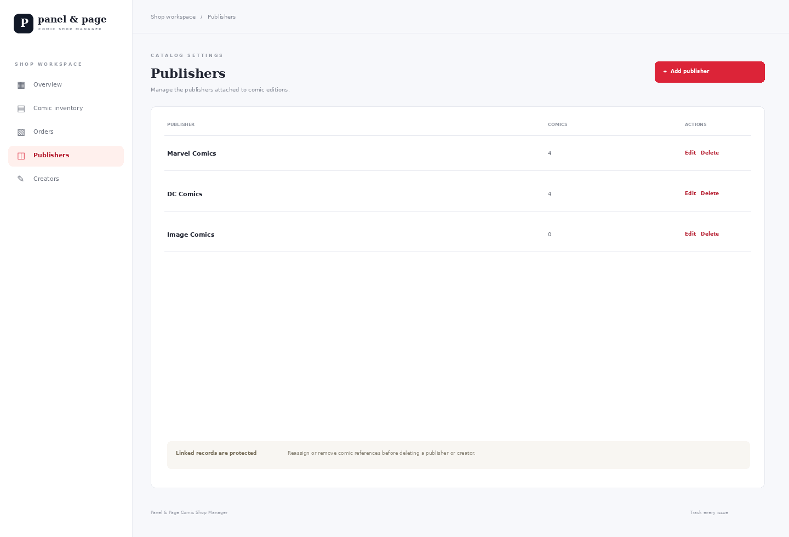
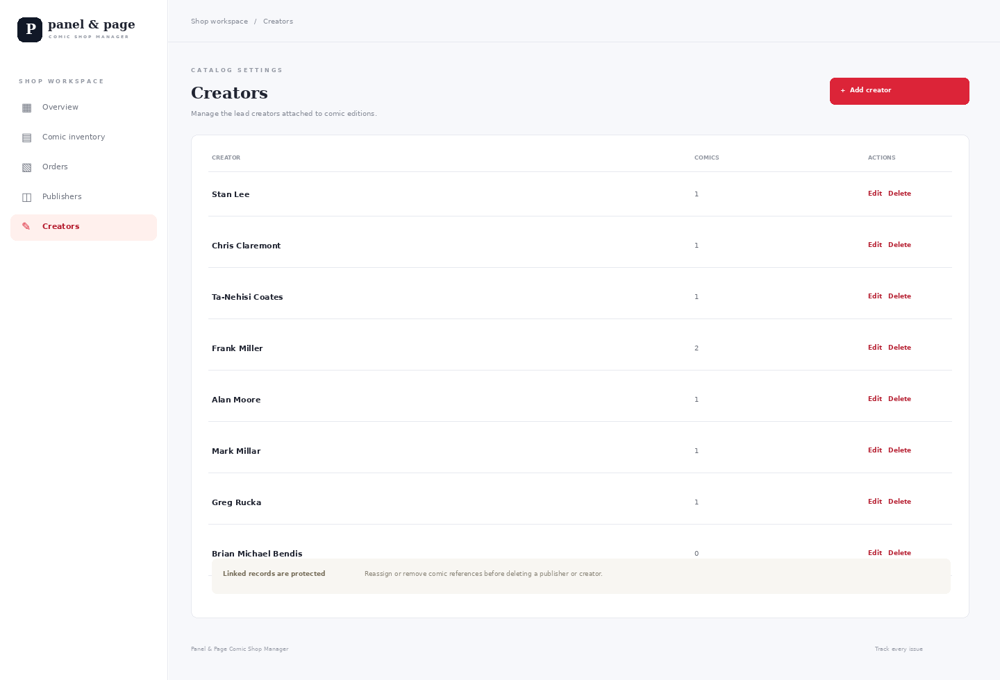
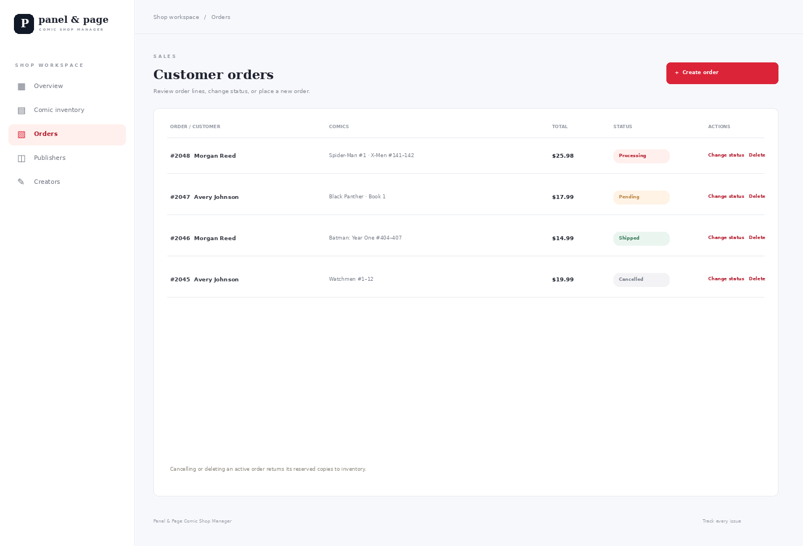

# Panel and Page Comic Shop Management System

**Prepared by:** Duane Harris  
**Project type:** Relational database application  
**Presentation date:** November 19, 2026  
**Repository:** https://github.com/duaneX1504/bookstore-management-system

## Project overview

Panel and Page is an inventory and order manager for a comic shop. It keeps a catalog of comic editions from Marvel and DC and records their series, issue or collected range, publisher, lead creator, genre, format, condition grade, price, and quantity. Store staff can search and filter the catalog, maintain comic records, review recent orders, export inventory, and see low-stock editions.

The seeded inventory includes actual published titles such as The Amazing Spider-Man, X-Men: Days of Future Past, Batman: Year One, and Watchmen. Official publisher catalogs list these titles. Stock quantities, store prices, catalog codes, and condition grades are made-up demonstration values.

## Technologies

| Layer | Technology |
| --- | --- |
| Frontend | HTML, CSS, JavaScript |
| Backend | PHP 8 with PDO |
| Database | MySQL 8 or MariaDB |
| Local server | XAMPP Apache and MySQL |
| API format | REST-style HTTP requests with JSON responses |

## Database design

The database contains seven tables. Publishers, creators, and genres are stored separately from comics so their names are not repeated in every catalog record. Each comic record identifies one lead creator. Customers can place multiple orders. Order items resolve the many-to-many relationship between orders and comics and store the quantity and sale price for each line.

| Table | Primary key | Main fields and relationships |
| --- | --- | --- |
| publishers | publisher_id | publisher_name, unique |
| creators | creator_id | creator_name, unique |
| genres | genre_id | genre_name, unique |
| comics | comic_id | catalog_code, title, series_title, issue_number, publisher_id FK, creator_id FK, genre_id FK, format, condition_grade, price, stock_qty |
| customers | customer_id | full_name, email, phone |
| orders | order_id | customer_id FK, order_date, status |
| order_items | order_id + comic_id | both foreign keys, quantity, unit_price |

The schema uses unique constraints for publisher names, creator names, genre names, catalog codes, and customer emails. Foreign keys protect related records. Price and quantity checks prevent negative values. The order API validates available inventory and inserts an order and its lines while reducing stock in one transaction. Cancelling an order restores the reserved copies. The order item retains unit_price even if the catalog price later changes.

## Frontend

The dashboard shows the number of catalog editions, total copies on hand, open orders, and low-stock editions. Its inventory table displays a comic title and series, publisher, issue or collected range, format, grade, price, and stock. Staff can search by title, series, issue, creator, or in-store catalog code and filter by publisher. The comic form supports create and update operations. Row actions delete editions when no order refers to them. The export button downloads the catalog as CSV. The sidebar opens dedicated Orders, Publishers, and Creators sections.

Publisher and creator screens support adding, renaming, and deleting records. Foreign keys prevent deleting a publisher or creator while a comic still references it. The Orders screen can place orders for existing customers, show each order's comics and total, change order status, cancel an order, or delete it. Cancelling or deleting an active order restores its reserved stock. Order line items and sale prices remain fixed after checkout so the order keeps its original details; to correct an order, cancel or delete it and create a replacement.

### Comic shop dashboard

The preview below shows the seeded Marvel and DC examples with the inventory controls and order summary.

### Comic entry form

The form stores comic and edition metadata, a store-assigned code, publisher, lead creator, genre, format, grade, price, and stock.

### Publisher and creator management

Staff can add, rename, and delete publisher and creator records. Foreign keys block deleting a record that is still assigned to a comic.

### Order management

The Orders section places orders for existing customers, shows comic line items and totals, changes statuses, cancels orders, and deletes orders. Cancelling or deleting an active order restores reserved stock. Order lines and sale prices are fixed after checkout to preserve the sale record; create a replacement order to correct its contents.

## Backend API

The PHP API uses PDO prepared statements and validates fields before writing to MySQL. Its comics, publishers, creators, genres, and customers resources support GET, POST, PUT/PATCH, and DELETE operations. Orders support reads, transactional creation with stock deduction, status updates, and deletion with stock restoration. API responses use JSON and HTTP status codes for success, validation failures, missing records, and related-record conflicts.

Example endpoints:

- GET /api/api.php?resource=comics
- GET /api/api.php?resource=comics&id=1
- POST /api/api.php?resource=comics
- PUT /api/api.php?resource=comics&id=1
- DELETE /api/api.php?resource=comics&id=1
- POST /api/api.php?resource=orders
- PUT /api/api.php?resource=orders&id=1

## Setup and demonstration

To recreate the application, copy the project folder into C:\xampp\htdocs, start Apache and MySQL, import database/schema.sql through phpMyAdmin, copy config.example.php to config.php, and visit http://localhost/bookstore-management-system/. The SQL file creates comic_store_db and inserts sample Marvel and DC catalog records.

For the class demonstration, show the comic catalog and database relationships, then add a temporary comic through the dashboard. Add a publisher or creator from its sidebar section and show that the database protects a record still assigned to a comic. Create an order in the Orders section and show the reduced stock. Change its status to Cancelled and show the copies return to inventory.

## Project repository and sources

Repository: https://github.com/duaneX1504/bookstore-management-system

Marvel title references:

- The Amazing Spider-Man: https://www.marvel.com/comics/series/32866/the_amazing_spider-man
- X-Men: Days of Future Past: https://www.marvel.com/comics/collection/41778/x-men_days_of_future_past_tpb_new_printing_trade_paperback

DC title references:

- Batman: Year One: https://www.dc.com/graphic-novels/batman-year-one-1987/absolute-batman-year-one
- Watchmen: https://www.dc.com/graphic-novels/watchmen-1986/watchmen

## Scope and future work

This class project does not include logins, staff permissions, payment processing, shipping integrations, barcode scanning, or public hosting. A future version could add a comic_creators junction table for multiple writers and artists, publisher UPCs, pull-list reservations, barcode lookup, and sales reports.
